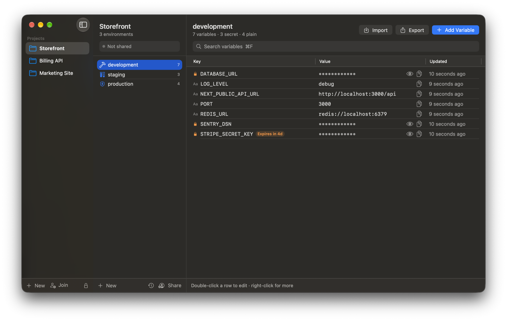
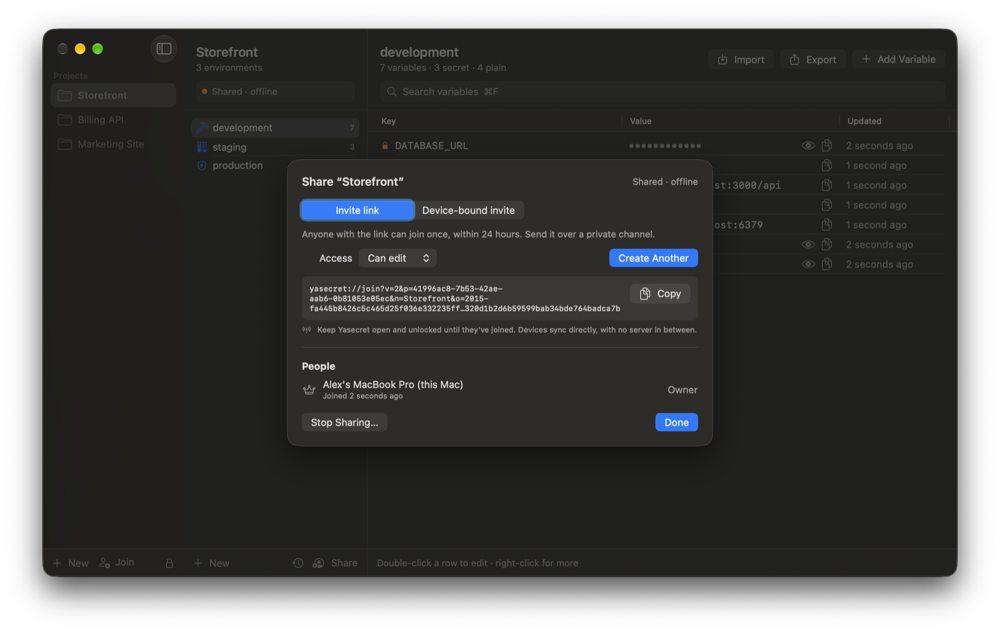
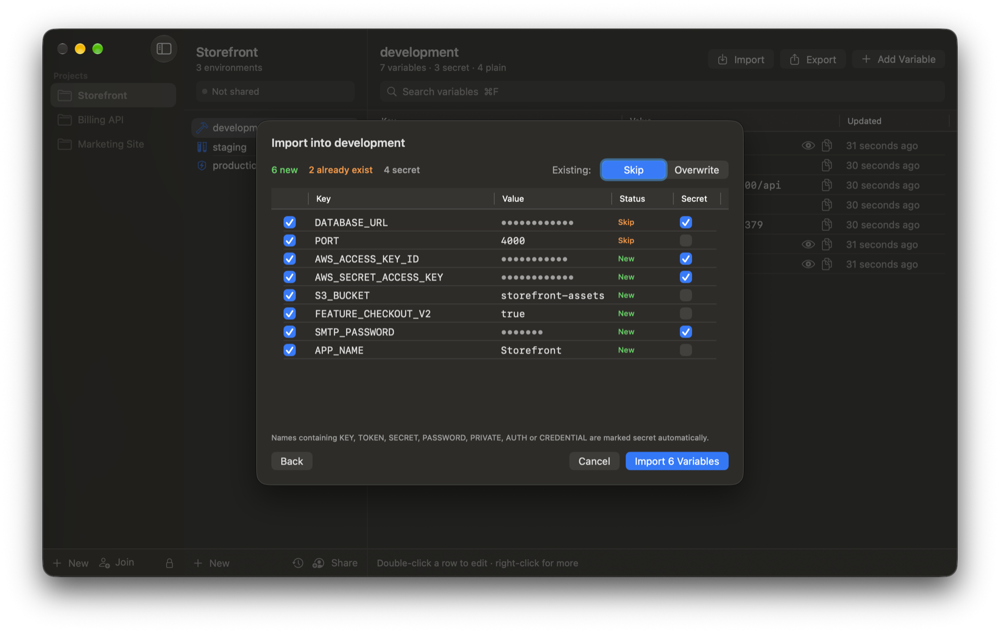
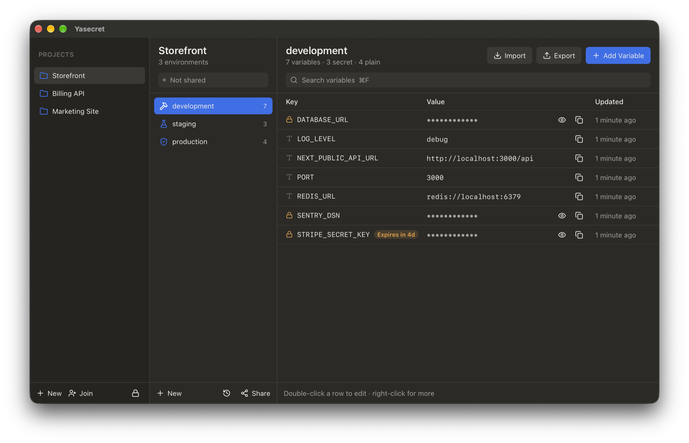

# Yasecret

A local-first secrets manager for `.env` files. Your variables live in an encrypted vault on your own machine, sync directly between your team's devices without a server, and can be used by scripts and AI coding agents without being pasted anywhere.

- **macOS app** (SwiftUI) and **Windows app** (Tauri), sharing one Rust core.
- **CLI** for pulling, pushing and diffing `.env` files, keeping one live while you develop, and running commands with secrets injected.
- **MCP server** so Claude Code can use secrets without seeing their values.



> Status: early (0.1). It works end to end and is covered by tests, but it has not had an external security review. Don't trust it with production credentials you can't rotate.

## Features

- **Projects, environments, variables.** Default development / staging / production environments, clone an environment, compare two side by side.
- **Plain and secret variables.** Secrets stay masked until revealed; plain values are shown. Names like `*_KEY`, `*_TOKEN`, `*_SECRET`, `*PASSWORD*` are flagged as secrets automatically.
- **Import** `.env` or JSON (paste, drop a file, or pick one) with a preview: new vs existing keys, skip or overwrite, per-row secret toggle.
- **Export** as `.env`, JSON, Docker Compose, Kubernetes Secret / ConfigMap, or a keys-only `.env.example`.
- **History** of every value with one-click restore, plus an **activity log** (adds, edits, deletes, reveals, synced changes).
- **Expiry dates** on variables with reminders a week before.
- **Sharing without a server.** Devices sync peer-to-peer; invite teammates with edit or view-only access.
- **Locking.** Touch ID / Keychain on macOS; Windows Hello on Windows (the remembered password lives in Credential Manager and Yasecret asks for Hello before using it); auto-lock on sleep or screen lock (macOS) or after 10 minutes idle (Windows). Copied secrets are cleared from the clipboard after 60 seconds.

## Screenshots

| Sharing a project | Importing a `.env` |
|---|---|
|  |  |

The desktop app (Tauri, the Windows build) has the same layout. Shown here running on macOS:



## Install

Tagged versions are published on the [Releases](../../releases) page: a Windows installer (`*-setup.exe` per-user, `.msi` for managed installs) and a macOS app for Apple silicon and Intel (`Yasecret-macOS.zip`). Between releases, every push to `main` builds Windows installers you can download from the latest [Windows build](../../actions/workflows/windows.yml) run under *Artifacts*.

**Windows.** The app checks for updates on launch and offers to install them. Updates are signed with Yasecret's update key and verified before they're applied. The installer itself isn't code-signed yet, so SmartScreen will warn on first install; choose *More info → Run anyway*.

**macOS.** Releases are signed with Yasecret's own (self-signed) certificate, so every version has the same identity and Keychain access carries over when you update. It isn't an Apple Developer ID, so the first time, right-click *Yasecret.app → Open* (or run `xattr -dr com.apple.quarantine Yasecret.app`). You can also build from source (below).

**Cutting a release:** bump `version` in `desktop/src-tauri/tauri.conf.json`, then push a matching tag (`git tag v0.2.0 && git push origin v0.2.0`). The [Release](.github/workflows/release.yml) workflow builds both apps into a draft release; publishing the draft makes the update available. It needs the `TAURI_SIGNING_PRIVATE_KEY` and `TAURI_SIGNING_PRIVATE_KEY_PASSWORD` secrets; the Mac app is signed with the certificate in `APPLE_CERTIFICATE` / `APPLE_CERTIFICATE_PASSWORD` / `APPLE_SIGNING_IDENTITY`. Replacing that with a Developer ID certificate and adding `APPLE_ID`, `APPLE_APP_PASSWORD` and `APPLE_TEAM_ID` also notarizes it (users will need to allow Keychain access once after that switch).

## Typed variables

Give a variable a type (URL, number, port, boolean, email or JSON) in its editor; Yasecret suggests one from the name (`*_URL`, `*_PORT`, `ENABLE_*`…). Every change is checked against it: in the apps, on `yasecret push` (a push with a value that doesn't fit is refused as a whole) and on MCP imports. Types sync with the variable.

## Inheritance and references

An environment can **inherit** another's variables (right-click it → *Inherit From*, or `yasecret inherit -p app -e staging --from development`). Its own variables win, so staging only needs the values that differ. Inherited variables show under the environment's own, with *Override* to give it its own value.

Values can **reference** other variables: `DATABASE_URL=postgres://${DB_HOST}:${DB_PORT}/app`. A reference expands only when the name is a variable of that environment (inherited ones count), so text like `${HOME}` stays as written; write `$${` for a literal `${`. The vault stores values as written; `pull`, `run`, `env`, `dev`, exports and the MCP tools see them inherited and expanded.

## Recovery and backups

Set up a **recovery key** (Mac: *Vault → Recovery Key…*; Windows: the key button in the sidebar; CLI: `yasecret vault recovery-key`). It's shown once; keep it offline. If you forget the master password, use *Forgot password?* on the unlock screen (or `yasecret vault recover`) to set a new one. Changing the master password keeps the recovery key working; making a new key retires the old one.

**Back Up Vault** writes one encrypted file with every project. Restore it from the unlock screen (*Restore from backup…*) or with `yasecret vault restore <file>`, using the master password the vault had when the backup was made.

## How sharing works

Each project you share becomes a replicated document synced over [iroh](https://iroh.computer) (QUIC with NAT traversal and public relays). There is no Yasecret server; devices talk directly whenever both are open and unlocked.

- Values, and the names of projects, environments, variables and devices, are encrypted with a per-project AES-256-GCM key before they leave your machine. The vault file is encrypted with SQLCipher, and each project key is wrapped with a key derived from your master password using Argon2id.
- **Invite link:** single use, expires after 24 hours. It carries a one-time key that unwraps the project key, so send it over a private channel.
- **Device-bound invite:** your teammate sends you their device code (an X25519 public key); the project key is encrypted to that device only, so the link is safe to send anywhere.
- Every change is accepted only if its author holds an access grant signed by the project owner (Ed25519), and joiners must prove they hold the project key before they're admitted. Holding the doc ticket alone gets you nothing.
- **Co-owners.** The owner can make any member a co-owner. Co-owners can invite people, admit them and change or remove access while the owner is away; only the owner appoints or demotes co-owners or stops sharing. Grants a co-owner signed stop counting the moment they're demoted, and the owner re-signs them so the people they admitted keep their access.
- **Removing someone** rotates the project key and re-encrypts every value, so they can't read anything written afterwards. **Stop sharing** does the same for everyone.
- Conflicts resolve last-write-wins per variable; deletions sync as tombstones; every overwritten value stays in history.

### Always-on peer

Devices only sync while they're online at the same time. To keep a project reachable when your laptop is closed, run a relay on any machine that stays on (a server, a NAS, a Raspberry Pi):

```bash
yasecret relay code          # prints this relay's code
# In Yasecret: Share → Always-on peer → paste the code → Add, then run the command it gives you:
yasecret relay add 'yasecret://relay?...'
yasecret relay               # keep this running
```

Owners on a headless machine can use `yasecret share -p my-app --relay <code>` instead of the app. To run the relay as a service, use [`deploy/relay/yasecret-relay.service`](deploy/relay/yasecret-relay.service) (systemd) or the [Dockerfile](deploy/relay/Dockerfile):

```bash
docker build -f deploy/relay/Dockerfile -t yasecret-relay .
docker run -d --name yasecret-relay --restart unless-stopped -v yasecret-relay:/data yasecret-relay
docker run --rm -v yasecret-relay:/data yasecret-relay code
docker run --rm -v yasecret-relay:/data yasecret-relay add 'yasecret://relay?...'
```

The relay gets a read-only copy of the project document and never receives the project key. Project, environment, variable and member records are sealed with that key, so it can't read names or values; it can see how many records there are, device IDs and access levels, and the name you gave the relay. New invite links include the relay, so teammates can join and pick up changes while the owner is offline; the owner admits them the next time they're online (up to a week after the invite expires). Removing a relay stops members from dialing it, but it keeps what it already stored and devices that remember it may keep syncing with it; to cut a relay off completely, stop sharing and share the project again.

Limitations: without a relay, the owner's device must be online for someone to join. Only the owner and co-owners can invite or change access. Activity is shared: each device publishes its own entries (sealed, like everything else) and others show them under that device's name.

## CLI

```bash
cargo install --path crates/cli        # installs `yasecret`

yasecret pull --project my-app --env development -o .env
yasecret push --project my-app --env development -i .env   # adds new keys; --overwrite to replace, --dry-run to preview
yasecret diff --project my-app --env development -i .env   # key names only; exit 0 same, 1 different, 2 error (CI-friendly)
yasecret dev  --project my-app --env development -o .env   # rewrites .env whenever the environment changes
yasecret run  --project my-app --env development --only DATABASE_URL -- npm run migrate
eval "$(yasecret env -p my-app -e development)"            # load into the current shell (--shell fish|powershell)
yasecret example -p my-app -e development -o .env.example  # keys only, secrets marked
yasecret check -p my-app -e production                     # every key in .env.example set? (or --file .env)
yasecret scan                                              # vault secrets in this repo? (--staged, --history)
yasecret peers self                    # this device's code, for device-bound invites
yasecret share --project my-app        # prints an invite link and stays online until you stop it
yasecret join 'yasecret://join?...'
```

For [direnv](https://direnv.net), put `eval "$(yasecret env -p my-app -e development)"` in `.envrc`. To stop secrets from being committed, add a pre-commit hook (`.git/hooks/pre-commit`):

```bash
#!/bin/sh
exec yasecret scan --staged
```

`scan` only reports the file, line and key name, never the value. `check`, `diff` and `scan` exit 0 when everything is fine, 1 when they find a problem and 2 when they couldn't check, so they fit in CI.

`push` stores names that look sensitive (`*_KEY`, `*PASSWORD*`, `*TOKEN*`…) as secrets and the rest as plain variables. `dev` also picks up changes the desktop app syncs in from teammates. `run` injects only the variables you name with `--only`, and masks their values in the command's output. The CLI prompts for your master password. While the desktop app is running it owns the sync node, so share and join from the app instead.

## VS Code

The [extension](vscode/) shows your projects, environments and variable names in a sidebar, copies values, inserts references in the file's language (`process.env.API_KEY`, `os.environ["API_KEY"]`…), writes `.env` files and explains references on hover. It uses the `yasecret` CLI, passing the master password over standard input and keeping it in memory only until it locks again. Releases include the `.vsix`; install it with *Extensions → … → Install from VSIX*.

## Claude Code (MCP)

```json
{
  "mcpServers": {
    "yasecret": { "command": "yasecret", "args": ["mcp"] }
  }
}
```

Tools: `list_projects`, `list_secret_keys` (names only), `run_with_secrets` (injects values and masks them in the output returned to Claude), `import_env`, and `get_secret`, which returns a plaintext value only when `YASECRET_MCP_ALLOW_PLAINTEXT=1` is set. The macOS app notifies you when an MCP client gets access.

Known limitation: `yasecret mcp` currently prompts for the master password on a terminal, so it can't unlock when an MCP client launches it in the background. Unattended unlock is on the roadmap.

## Build from source

Requirements: Rust (stable), and for the apps either Xcode 15+ with [XcodeGen](https://github.com/yonaskolb/XcodeGen) (macOS) or Node 22 + pnpm (Windows/Linux desktop).

```bash
cargo test --workspace --exclude yasecret-desktop     # core, sync, CLI, FFI

# macOS app
cd macos && xcodegen generate && cd ..
xcodebuild -project macos/Yasecret.xcodeproj -scheme Yasecret build

# Desktop app (Tauri)
cd desktop && pnpm install
pnpm tauri dev                         # run locally
pnpm tauri build                       # installers for the current OS
```

The macOS build signs with an Apple Development identity (see `macos/project.yml`); change `DEVELOPMENT_TEAM` to your own team or set signing to automatic.

## Layout

| Path | What |
|---|---|
| `crates/core` | Vault: SQLCipher storage, crypto, projects, environments, variables, history, audit log, `.env` parsing and export |
| `crates/sync` | Peer-to-peer sync service on iroh: invites, grants, reconcile |
| `crates/ffi` | `YasecretSession`, the API both apps use (UniFFI bindings for Swift, plain Rust for Tauri) |
| `crates/cli` | `yasecret` CLI and MCP server |
| `macos/` | SwiftUI app |
| `desktop/` | Tauri v2 app (React + TypeScript + Tailwind) for Windows; Linux builds but is untested |
| `docs/superpowers/` | Design spec and implementation plans |

## License

Yasecret is free software under the [GNU Affero General Public License v3.0 or later](LICENSE). You can use, study, modify and share it; if you distribute it, or run a modified version as a network service, you must make your source code available under the same license.
